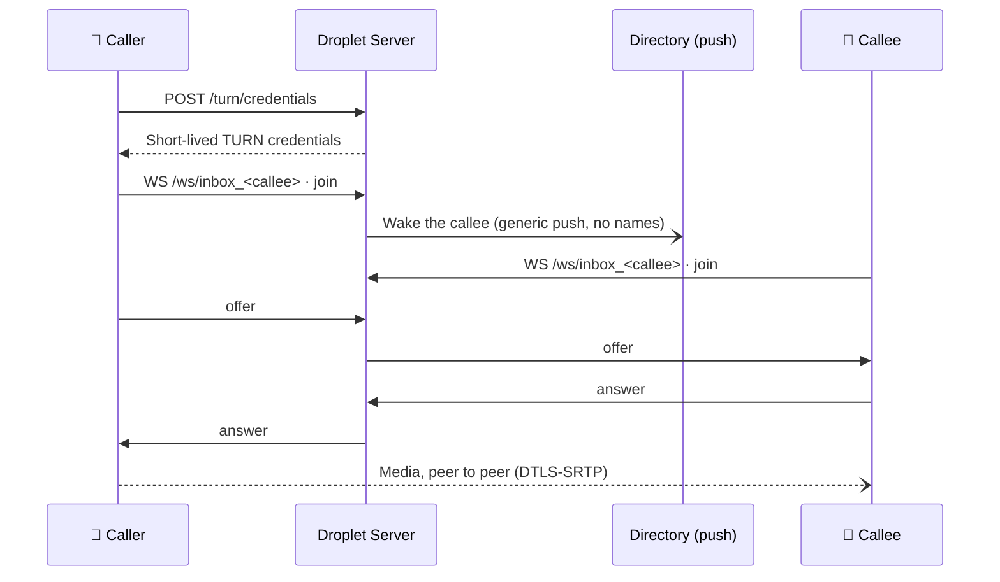

<div align="center">


# Droplet Server

**WebRTC signalling and TURN credentials for Droplet calls.**

A single, dependency-light Dart service that introduces two phones to each other — then gets out of the way.


[**Droplet**](https://dropletmesh.app) &nbsp;·&nbsp; [**The app**](https://github.com/rito27959-arch/droplet)

</div>

<br>

## Role

When a Droplet call goes over the internet rather than the local mesh, the two phones need a place to exchange WebRTC offers, answers and ICE candidates. This server is that meeting point. It **relays signalling messages only**: audio and video flow directly between the phones (or through TURN when a direct path is impossible) and are end-to-end encrypted by WebRTC.



## API

| Method | Path | Purpose |
|:--|:--|:--|
| `GET` | `/health` | Health check |
| `POST` | `/turn/credentials` | Issues temporary TURN credentials (Cloudflare Calls TURN) |
| `WS` | `/ws/:roomId` | Signalling for a room: `join`, `offer`, `answer`, `frappe` (typing), `leave` |

Each device keeps its own personal room, `inbox_<peerId>`, open so it can be reached without prior coordination. When someone joins a room whose owner is absent, the server asks the Droplet directory to wake that phone with a deliberately generic notification — *“Someone is trying to reach you on Droplet”*. The server knows technical identifiers only, never names.

## Configuration

All configuration comes from environment variables. **No secret is stored in this repository.**

| Variable | Purpose |
|:--|:--|
| `PORT` | Listening port (default `8082`) |
| `CLOUDFLARE_TURN_KEY_ID`, `CLOUDFLARE_TURN_API_TOKEN` | TURN credential issuance |
| `CLE_INTERNE` | Shared key that lets Droplet's own servers trigger wake-up pushes |
| `DIRECTORY_URL` | Directory service URL |

## Run

```sh
dart pub get
dart run lib/server.dart
```

Or as a container — a native AOT binary on `debian:bookworm-slim`, with root certificates so outgoing HTTPS (push wake-ups, TURN) verifies correctly:

```sh
docker build -t droplet-server .
docker run -p 8082:8082 --env-file .env droplet-server
```

## Deployment

Railway deploys `main`. Pushing to the `verif` branch first runs `dart analyze` and an AOT compile in CI, and publishes the log to the `journal` branch.

<br>

<div align="center">
<sub>
<a href="https://dropletmesh.app">Droplet</a> &nbsp;·&nbsp;
<a href="https://dropletid.dropletmesh.app">Droplet ID</a> &nbsp;·&nbsp;
<a href="https://drop.dropletmesh.app">Droplet Drop</a> &nbsp;·&nbsp;
<a href="https://web.dropletmesh.app">Droplet Web</a>
<br><br>
Designed and built in Yaoundé, Cameroon.
</sub>
</div>
